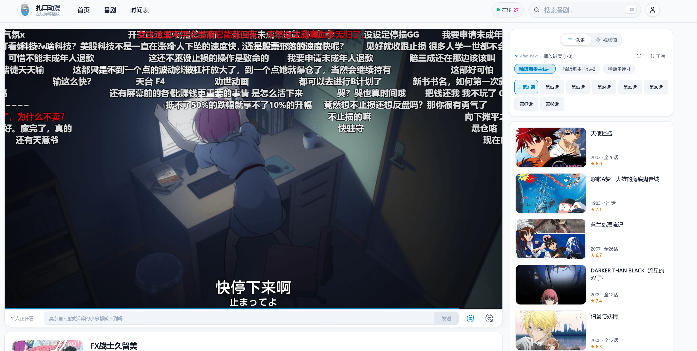

  <h1>扎口动漫</h1>

  

  
<strong>现代化二次元番剧流媒体客户端 · 为极致追番体验而生</strong>

  

    
  

  

    🌐 <strong>立即体验：</strong><a href="https://zakoway.com/" target="_blank"><strong>https://zakoway.com/</strong></a>
  

  
集高清直链、弹幕聚合、实时超分、智能跳过于一体的沉浸式追番平台 (～￣▽￣)～

---

## 📸 界面预览

  
  

---

## ✨ 核心功能亮点

### 📺 沉浸式流媒体播放
* **超清画质极速播放**：开箱支持 1080P 超清流畅直链，秒开加载，拒绝等待与转圈。
* **画面超分辨率画质增强**：支持实时超分辨率增强，画面更锐利、线条更清晰，老番与低清番剧重焕新生。
* **智能跳过片头片尾 (OP/ED)**：根据精准时间戳智能跳过 OP/ED，追番追剧连播体验行云流水。
* **广告切片智能过滤**：纯净观影体验，自动拦截并过滤第三方公共切片源内置广告。
* **多视频源自由切换**：聚合多条高质量播放线路，支持播放时一键秒级换源，支持线路自定义排序与优选。
* **画面比例自适应调节**：支持 16:9、4:3、铺满全屏以及原始比例自由切换。
* **高级播放器工具箱**：
  * **原画一键截图**：精准截取当前帧超清画面，收藏精彩壁纸。
  * **水平镜像翻转**：支持画面左右翻转，满足特异观影需求。
  * **画中画悬浮窗**：支持将播放器置顶悬浮在桌面角落，工作摸鱼追番两不误。

### 💬 弹幕互动与聚合系统
* **跨平台弹幕海量聚合**：汇聚丰富弹幕库，精彩吐槽与共鸣实时同步，重温与同好刷屏的快乐。
* **进度条高能弹幕热力图**：播放进度条直观展示弹幕密集度波峰图，名场面、高能伏笔、催泪瞬间一目了然。
* **弹幕智能防挡与个性定制**：支持智能防挡字幕，支持弹幕字号大小、透明度、滚动速度微调与黑名单屏蔽词过滤。
* **弹幕时间轴微调与偏移对齐**：支持按秒级提前、延后或复位弹幕偏移量，轻松解决不同片源音画与弹幕错位问题。
* **本地弹幕文件导入**：支持导入本地 XML 弹幕文件与外挂弹幕包。

### 📅 番剧日历与全方位探索
* **周更放送时刻表**：周一至周日番剧更新日程表清晰明了，当日更新番剧动态一手掌握。
* **实时观看排行榜**：基于真实观看热度与追番人数统计，热门动画榜单实时呈现。
* **智能检索与深度维基**：
  * 支持按季度、开播年份、题材风格多维度筛选与关键词联想搜索。
  * 涵盖详尽的番剧介绍、声优阵容（CV）、制作人员（STAFF）与维基评分。

### 📚 追番管理与进度同步
* **状态分类管理**：支持将番剧归类为「想看」、「在看」、「看过」，轻松打理专属于自己的追番书架。
* **主流番组进度双向云同步**：打通主流动画档案平台，个人进度实时同步，换设备换浏览器永不丢失。
* **智能断点续播**：精确记录每部番剧历史播放集数与进度秒数，再次打开瞬间接续精彩。

### 🎨 现代化交互与视效设计
* **深色 / 浅色模式自由切换**：夜间观影不刺眼，明亮模式更清新，贴心呵护用眼舒适。
* **多场景观影布局**：提供系统级全屏、网页全屏、宽屏剧场模式随心挑选。
* **桌面端键盘快捷键**：深度优化键位映射，空格暂停、方向键快进退/调音量，单手即可轻松操作。
* **移动端触控手势操控**：针对手机/平板触屏全面适配双击启停、长按 2.0X 极速快进、左右滑动精确寻轨。
* **灵动交互挂件**：右下角常驻互动看板娘与一键回到顶部趣味动效。

---

## ⌨️ 常用快捷操作一览

| 快捷键 / 手势 | 对应功能 |
| :--- | :--- |
| `Space` / `K` | 播放 / 暂停 |
| `←` / `→` | 快退 5 秒 / 快进 5 秒 |
| `↑` / `↓` | 音量调整 ±5% |
| `F` | 进入 / 退出系统全屏 |
| `Shift + W` | 网页全屏模式 |
| `W` | 切换画面比例 (16:9 / 4:3 / 铺满 / 原始) |
| `D` | 显示 / 隐藏弹幕 |
| `Alt + M` | 打开弹幕个性化调节面板 |
| `,` / `.` / `/` | 弹幕时间轴微调 (延后 / 提前 / 重置偏移) |
| `P` / `N` | 切换 上一集 / 下一集 |
| `鼠标右键` | 打开播放器高级功能菜单 (超分 / 原画截图 / 镜像 / 画中画) |
| **移动端双击** | 播放 / 暂停 |
| **移动端长按** | 2.0X 极速快进 |
| **移动端横向滑动** | 快速寻轨快进 / 快退 |

---

## 🔒 纯净声明

* **无商业追踪与弹窗**：不内置任何商业追踪 SDK，尊重用户隐私，所有历史记录与偏好设置均保存在本地。
* **免责声明**：本项目仅作为现代化客户端前端与浏览播放工具，不存储、不分发任何音视频资源，内容均来源于网络公开索引。